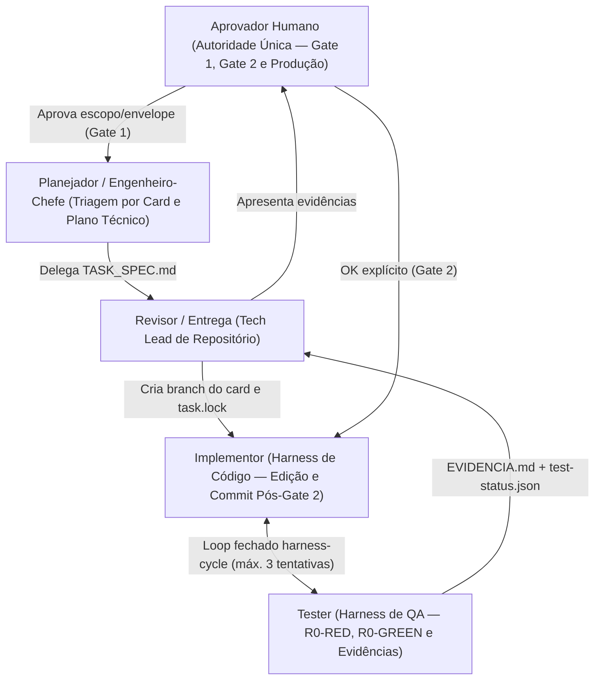

# Engineering Flow 5.0

> **Workflow de engenharia agnóstico de ferramenta, baseado em hierarquia de papéis, entrega por card e instalação limpa.**

Versão atual: **`5.0.0`** · [Releases no GitHub](https://github.com/OliveiraDotnet/engineering-flow/releases) · [Índice de Skills](SKILLS-INDEX.md) · [Manual de Uso](MANUAL_DE_USO.md) · [Guia Detalhado](INSTRUCOES_DETALHADAS.md) · [Changelog](CHANGELOG.md)

---

## O que é o Engineering Flow 5.0

O **Engineering Flow** é um método prático para descobrir sistemas, triar demandas por card (`AB-<ID>`), planejar tecnicamente, implementar em loop fechado com validação real e entregar mudanças em homologação e produção com rastreabilidade.

A linha **5.0** torna o fluxo **100% agnóstico de ferramenta e de persona**:

- **Sem acoplamento a CLI, IDE ou orquestrador proprietário:** você pode usar qualquer harness de código/IA no terminal ou no editor.
- **Dois modos de operação com o mesmo contrato:**
  1. **Modo Harness Único (Standalone):** uma única pessoa e um único harness acumulam todos os papéis da hierarquia do início ao fim.
  2. **Modo Multi-Agente (Hierarquia Bottom-Up):** os papéis são distribuídos entre bots/agentes especializados construídos da base para o topo (`Tester` + `Implementor` → `Revisor/Entrega` → `Planejador`), comunicando-se via contratos em arquivo.
- **Instalação limpa em repositórios compartilhados:** **somente o `AGENTS.md` fica versionado** no Git; nenhum arquivo de versão/estado (`.agent-pack/state.txt`) ou pasta de método é subido para o repositório da equipe.

Inclui especialização para **.NET moderno e .NET Framework**, **Web Forms**, **ASP clássico**, **HTML/CSS/JavaScript**, **SQL Server** e **Mobile** (nativo/híbrido/multiplataforma), além de investigação contextual para qualquer outra stack.

---

## Hierarquia de Papéis e Loop Fechado



| Papel | Responsabilidade Principal | Pode Commitar? | Pode Dar Push? |
| :--- | :--- | :---: | :---: |
| **Aprovador Humano** | Única autoridade decisória (`sole decision authority`); aprova Gate 1, Gate 2 e subida para produção. | Manual se necessário | Manual se necessário |
| **Planejador / Engenheiro-Chefe** | Garante triagem por card (`AB-<ID>`), fecha plano técnico no Gate 1 e delega aos repositórios. | Não | Não |
| **Revisor / Entrega (Tech Lead)** | Mantém `Planejamento/DEMANDAS.md`, cria branch do card e `task.lock`, revisa diff/evidências, gerencia PR, homologação, promoção isolada para `main`/`master`, Tag `vX.Y.Z`, SQL consolidado e OS de Infra. | Não | Sim |
| **Implementor (Harness)** | Edita o código-fonte na branch do card, corrige falhas apontadas pelo `Tester` e executa `git commit` exclusivamente após Gate 2 (`--commit-gate2`, expirando o `task.lock`). | **Sim (pós-Gate 2)** | Não |
| **Tester (Harness)** | Nunca altera código de negócio; prova `R0-RED` antes do fix em bugs, executa `R0-GREEN` e suíte `FULL`, gravando `.agent-pack/evidencias/<CardId>/EVIDENCIA.md` e `.agent-pack/.runtime/test-status.json`. | Não | Não |
| **Publicador / Validador (Opcional)** | Audita branches/releases ou executa publicação quando acionado pelo aprovador humano. | Não | Opcional |

> No **Modo Harness Único (Standalone)**, o mesmo harness segue exatamente essa ordem de responsabilidades (planejar e pedir Gate 1 → provar `R0-RED` → implementar → provar `R0-GREEN` e evidências → pedir Gate 2 antes de commitar). Veja [workflow.md](repo-template/docs/engineering-flow/workflow.md) e [ASSISTENTE_WORKFLOW.md](ASSISTENTE_WORKFLOW.md).

---

## Ciclo de Trabalho e Gates

1. **Triagem por Card (`AB-<ID>`):** nenhuma tarefa começa sem card identificado. Em modo multi-repositório, é registrada em `Planejamento/DEMANDAS.md`.
2. **Descoberta & Saúde de Testes no Legado:** entende o contexto antes de propor solução. Em código legado altamente acoplado, **não** força refatoração arriscada para criar testes unitários artificiais; sobe a validação para **Playwright E2E completo**.
3. **Gate 1 (Plano Técnico):** apresenta plano, envelope de alteração, riscos e, em bugs, o teste de regressão obrigatório **`R0`** (somente o aprovador humano pode dispensar o `R0`, com motivo registrado).
4. **Branch do Card e LOCK:** branch criada a partir de `main`/`master` (`feat/AB-<ID>-<slug>` ou `fix/AB-<ID>-<slug>`), protegida por `.agent-pack/.runtime/task.lock`.
5. **Ciclo `harness-cycle` (`Implementor` ↔ `Tester`):**
   - Em bugs, `Tester` comprova `R0-RED` (falha antes da correção).
   - `Implementor` aplica a correção na working tree (sem commitar).
   - `Tester` comprova `R0-GREEN` e executa apenas os testes aprovados (`FULL`), gerando `EVIDENCIA.md` e `test-status.json` (disjuntor automático de no máximo 3 tentativas).
6. **Gate 2 (Evidência e Commit):** testes não solicitados não rodam automaticamente; falhas impedem entrega como validada. Após ver as evidências reais e dar o **ok explícito**, apenas o `Implementor` executa `git commit` (`--commit-gate2`), expirando o `task.lock`. Nunca comita na `main`/`master` e nunca executa force push.
7. **Homologação e Produção Isolada:** merge na homologação mantendo a branch do card viva; após validação em homologação e aprovação humana, promoção isolada apenas da branch aprovada na `main`/`master`, criação da Tag `vX.Y.Z`, pacote SQL consolidado da Tag e geração de `OS-INFRA-vX.Y.Z.md` ([DIRETRIZ-entrega-pelo-bot-de-projeto.md](diretrizes/DIRETRIZ-entrega-pelo-bot-de-projeto.md)).

Modos de execução: **Trivial** (1 critério observável, sem risco a dados/migração) e **Completo** (Gate 1 e Gate 2 obrigatórios); na dúvida, **Completo**.

---

## Instalação Limpa 5.0 (Apenas `AGENTS.md` Versionado)

Na versão **`5.0.0`**, instalar o Engineering Flow em um repositório de equipe é limpo por padrão:

- **Não gera arquivos de versão/estado (`.agent-pack/state.txt`)** no repositório destino.
- **Atualiza o `.gitignore` automaticamente** para ignorar todas as pastas operacionais do pack (`.agents/`, `.grok/`, `.agent-pack/`, `docs/engineering-flow/`, `docs/ai/`, `prompts/`, `Planejamento/`, `planejamento/`, `.engineering-flow-evidence/`, `*.agent-pack.new`, `*.agent-pack.backup-*`).
- **Somente `AGENTS.md` permanece versionável no Git**, evitando subir arquivos do seu fluxo pessoal para outros desenvolvedores do time.

### Baixar ou Clonar

Baixe o pacote da [Release `v5.0.0`](https://github.com/OliveiraDotnet/engineering-flow/releases/tag/v5.0.0) ou clone o repositório:

```bash
git clone --branch v5.0.0 https://github.com/OliveiraDotnet/engineering-flow.git
```

### Instalar em um Repositório Alvo

Execute a partir da raiz do `engineering-flow`, apontando para o repositório Git destino (ou para uma pasta contendo vários repositórios):

```bash
# Linux / macOS (Bash)
bash ./scripts/install-agent-pack.sh /caminho/do/repositorio --discover-only
bash ./scripts/install-agent-pack.sh /caminho/do/repositorio --profile web,sqlserver --dry-run
bash ./scripts/install-agent-pack.sh /caminho/do/repositorio --profile web,sqlserver
bash ./scripts/install-agent-pack.sh /caminho/do/repositorio --profile web,sqlserver --force
```

```powershell
# Windows (PowerShell 7+)
.\scripts\install-agent-pack.ps1 -RepoPath 'C:\src\Sistema' -DiscoverOnly
.\scripts\install-agent-pack.ps1 -RepoPath 'C:\src\Sistema' -Profile web,sqlserver -DryRun
.\scripts\install-agent-pack.ps1 -RepoPath 'C:\src\Sistema' -Profile web,sqlserver
.\scripts\install-agent-pack.ps1 -RepoPath 'C:\src\Sistema' -Profile web,sqlserver -Force
```

> Para pastas deliberadamente sem Git, use `--allow-non-git` / `-AllowNonGit`. Em atualizações sobre instalações antigas ou ignoradas no `.gitignore`, `--force` / `-Force` atualiza preservando backups `*.agent-pack.backup-*` caso algum arquivo tenha sido alterado localmente.

### Atualização Reconciliada (Repositórios com `state.txt` da linha 3.x / 4.x)

Se um repositório legado ainda mantiver `.agent-pack/state.txt`, você pode reconciliar sem perder customizações locais:

```bash
bash ./scripts/update-agent-pack.sh /caminho/do/repositorio --check
bash ./scripts/update-agent-pack.sh /caminho/do/repositorio --apply
```

```powershell
.\scripts\update-agent-pack.ps1 -RepoPath 'C:\src\Sistema' -Check
.\scripts\update-agent-pack.ps1 -RepoPath 'C:\src\Sistema' -Apply -Confirm:$false
```

`pack-manifest.txt`, `pack-artifacts.txt` e `pack-version.txt` definem artefatos e propriedade (`managed`, `merge`, `seed`). Catálogos de compatibilidade permanecem em `compat/releases/` (`1.1.0` a `5.0.0`).

---

## Perfis e Uso Diário

| Perfil | Quando Ativar | Conteúdo |
| :--- | :--- | :--- |
| `core` | Sempre | Descoberta (`$bootstrap-repo`), projeto novo, `$bugfix`, `$feature-slice`, `$refactor`, `$review-change`, `$complete-task`, `$harness-cycle` e contrato comum. |
| `web` | Explícito ou evidência de UI | Navegação, ASP clássico/SPA, Playwright E2E e especialização .NET Web. |
| `sqlserver` | Explícito ou SQL Server | Análise read-only, mudanças idempotentes por card (`PendentesProducao/`) e pacote de release por Tag. |
| `mobile` | Explícito ou app mobile | Planejamento e validação nativa/híbrida/multiplataforma (não instala SDK/emulador). |
| `quality` | Explícito (nunca automático) | Revisões focadas de segurança, desempenho e entrega. |

### Uso Rápido das Skills

1. Consulte o [índice de skills](SKILLS-INDEX.md) e carregue apenas a skill necessária para a demanda.
2. Em repositórios sem contexto mapeado, comece com `$bootstrap-repo` (`prompts/00-bootstrap-repo.md`).
3. Use `$bugfix`, `$feature-slice`, `$refactor`, `$review-change` ou `$new-project` conforme o card.
4. Para o loop fechado automatizado entre implementação e testes no harness, use **`$harness-cycle`** (`run-implementor`, `run-tester`, `supervise-harness`).
5. Encerre a entrega com `$complete-task`.

---

## Memória Persistente, Isolamento e Pré-Requisitos

- **Memória e Handoffs:** combina documentação local em `docs/ai/` com suporte opcional ao **`ai-memory` (`akitaonrails/ai-memory`)** via `.ai-memory.toml` / MCP quando configurado no harness. Como bots externos não compartilham necessariamente a memória MCP do harness, os handoffs inter-agentes ficam sempre explícitos em arquivos (`TASK_SPEC.md`, `EVIDENCIA.md`, `test-status.json`, `Planejamento/DEMANDAS.md`).
- **Requisitos locais para os scripts do pack:**
  - **Linux / macOS:** `bash` e `git` (os scripts `.sh` rodam localmente sem runtime extra).
  - **Windows:** **PowerShell 7+** (`pwsh`, `#Requires -Version 7`) e `git`.
  - O pack **não instala** SDKs, browsers ou dependências da sua aplicação (`xUnit`, `Playwright`, `bUnit`, `Testcontainers`).

### Documentação Relacionada

- [Contrato Canônico de Workflow](repo-template/docs/engineering-flow/workflow.md)
- [Anti-Padrões (leitura prévia obrigatória)](repo-template/docs/engineering-flow/anti-patterns.md)
- [Capacidades e Limites de Validação](repo-template/docs/engineering-flow/capabilities.md)
- [Workspace de Planejamento (`Planejamento/DEMANDAS.md`)](repo-template/docs/engineering-flow/planning-workspace.md)
- [Pacote SQL de Release por Tag](repo-template/docs/engineering-flow/sql-release-package.md)
- [Hierarquia Multi-Bot (Operação Opcional)](ASSISTENTE_WORKFLOW.md) · [Assistente Opcional](ASSISTENTE_OPCIONAL.md)
- [Diretriz de Entrega pelo Revisor/Bot de Projeto](diretrizes/DIRETRIZ-entrega-pelo-bot-de-projeto.md)
- [Manual de Uso](MANUAL_DE_USO.md) · [Instruções Detalhadas](INSTRUCOES_DETALHADAS.md)
