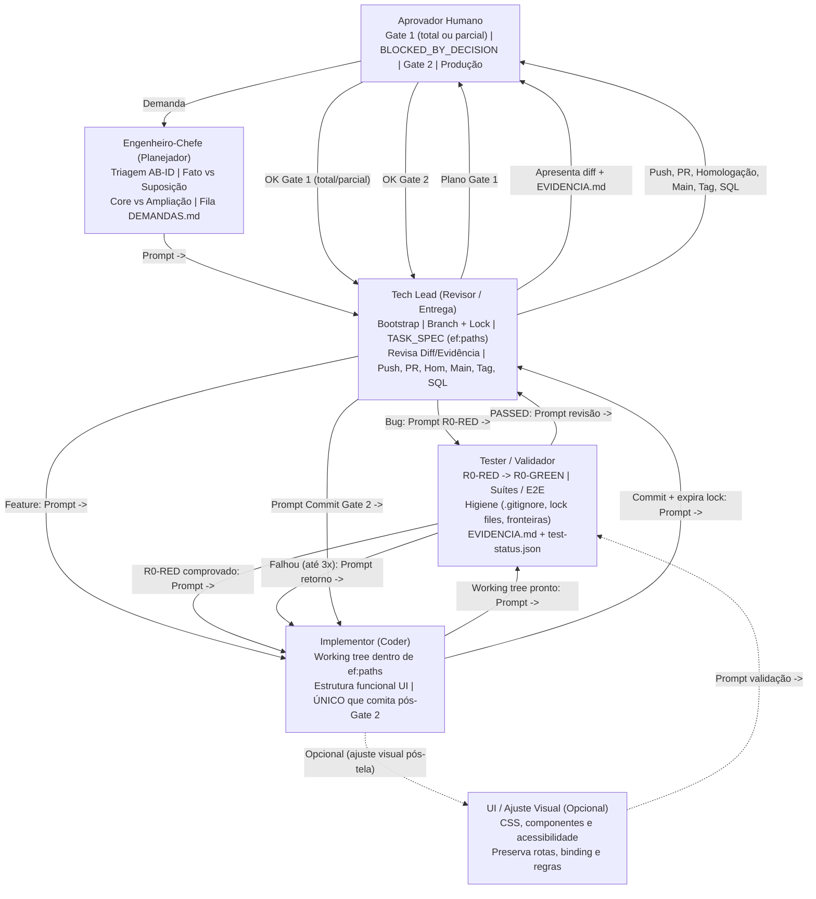

# Papéis, Fronteiras e Passagem de Bastão (Cada Um no Seu Quadrado)

Documento de referência operacional do Engineering Flow 5.1 para separar responsabilidades entre sessões/conversas independentes, sem dependência de ferramenta específica. O contrato de execução e os Gates permanecem em [workflow.md](workflow.md).

## 1. Modos de operação

Declarado em `AGENTS.md` (`Convenções do projeto` → `Modo de operação dos papéis`):

- **`sessao-por-papel` (padrão quando nada for especificado):** cada conversa assume **um único papel**. Quem planeja não codifica na mesma sessão; quem codifica não aprova os próprios testes; quem revisa e entrega não edita código de negócio nem executa `git commit` no lugar do `Implementor`. Toda troca entre papéis acontece via **artefatos em disco** + **bloco de prompt de passagem** emitido ao final do turno.
- **`standalone`:** uma única conversa acumula os papéis na ordem exata do `workflow.md` (sem pular Gate 1, `R0` nem Gate 2).

Ao iniciar uma conversa em modo `sessao-por-papel` (ou quando `Modo de operação dos papéis` não estiver preenchido em `AGENTS.md`):
1. Identifique qual papel foi atribuído à sessão (se não estiver explícito, pergunte antes de agir).
2. Leia **apenas** este documento, `AGENTS.md` e os artefatos de entrada do seu papel (evitando carregar o repositório inteiro).
3. Nunca invada o quadrado de outro papel na mesma conversa; quando precisar do próximo papel, atualize seus artefatos em disco e emita o **Prompt de Passagem**.

---

## 2. Diagrama de responsabilidades e passagem de bastão



---

## 3. Resumo dos papéis

| Papel | Função principal | Escreve código de negócio? | Cria/altera testes? | Faz `git commit`? | Faz `git push`? |
|---|---|---|---|---|---|
| **Aprovador Humano** | Única autoridade decisória (`sole decision authority`) | Não | Não | Manual se necessário | Manual se necessário |
| **Engenheiro-Chefe** | Triagem multi-projeto, `AB-<ID>`, escopo e cobrança de fila | **Não** | **Não** | **Não** | **Não** |
| **Tech Lead (Revisor / Entrega)** | Dono do repositório: `TASK_SPEC.md`, branch, lock, revisão, PR, homologação, `main`, Tag e SQL | **Não** | **Não** | **Não** | **Sim** (pós-Gate 2) |
| **Implementor (Coder)** | Implementação na branch do card dentro de `ef:paths` e estrutura funcional de tela | **Sim** | Só se previsto no `TASK_SPEC.md` | **Sim (único, pós-Gate 2)** | **Não** |
| **Tester / Validador** | `R0-RED`, `R0-GREEN`, suítes aprovadas, E2E, evidências e auditoria de higiene/segurança | **Não** | **Sim** (testes do envelope) | **Não** | **Não** |
| **UI / Ajuste Visual** *(opcional)* | Padrões visuais, CSS, responsividade e acessibilidade em telas já programadas | **Não** (só CSS/UI visual) | **Não** | **Não** | **Não** |

---

## 4. Responsabilidades por papel ("Cada um no seu quadrado")

### 4.1 Engenheiro-Chefe (Planejador)

| Responsável por | Não faz |
|---|---|
| Receber demandas brutas e garantir Card (`AB-<ID>`) antes de qualquer código | Escrever ou editar código-fonte, SQL de implementação ou testes |
| Separar **Fato**, **Suposição** e **Pergunta aberta**; classificar **Core/Contratual** vs. **Necessário** vs. **Ampliação de escopo** | Abrir branch ou adquirir `task.lock` em repositório |
| Acompanhar `Planejamento/DEMANDAS.md` entre projetos (em dev, paradas em homologação, prontas para produção) | Aprovar Gate 1, Gate 2 ou subida para produção no lugar do humano |
| Consolidar decisões/bloqueios para o Aprovador Humano e gerar o prompt de entrada para o **Tech Lead** | Executar `git commit` ou `git push` |

### 4.2 Tech Lead (Revisor / Entrega do Repositório)

| Responsável por | Não faz |
|---|---|
| Bootstrap (`$bootstrap-repo` / `$new-project`), manutenção de `AGENTS.md` e `docs/ai/*` (`decisions-and-pendencies.md`, `external-boundaries.md`, etc.) | Implementar código da demanda no mesmo papel em que planejou/revisou |
| Avaliar saúde de testes no legado (unit/int vs. Playwright E2E) e montar o plano do **Gate 1** | Executar `git commit` do card ou rodar os runners (`supervise-harness`, `run-*`, `--commit-gate2`) |
| Criar branch do card (`feat/AB-<ID>-<slug>` ou `fix/AB-<ID>-<slug>` a partir da `main`/`master`), adquirir `task.lock` (`tools/task-lock acquire`) e atualizar `Planejamento/DEMANDAS.md` | Alterar escopo, dependências ou saídas externas sem retornar ao Aprovador Humano (`BLOCKED_BY_DECISION`) |
| Gravar `.agent-pack/.runtime/TASK_SPEC.md` com o bloco explícito `ef:paths` (somente caminhos de arquivos individuais autorizados) | Dar por aprovado critério sem `EVIDENCIA.md` e `test-status.json` reais e sem `SECRET_IN_LOG` limpo |
| Revisar `git diff` + `EVIDENCIA.md`, apresentar o **Gate 2** ao Aprovador Humano, fazer `git push`, PR, merge em homologação, promoção isolada para `main`, Tag `vX.Y.Z`, SQL consolidado e `OS-INFRA` | Excluir branch do card antes do merge na `main` e da Tag |

### 4.3 Implementor (Coder)

| Responsável por | Não faz |
|---|---|
| Ler `prompts/12-implementor-harness.md`, `TASK_SPEC.md`, `test-status.json`, `decisions-and-pendencies.md` e `external-boundaries.md` antes de codificar | Alterar arquivos fora do `ef:paths` / envelope aprovado ou refatorar código fora do escopo |
| Implementar a solução no working tree da branch do card (sem commits intermediários durante o loop com o `Tester`) | Criar saída externa fora de `external-boundaries.md` ou tocar item bloqueado por `Pxx` (deve parar com `BLOCKED_BY_DECISION`) |
| **Desenhar e programar a estrutura funcional das telas** (composição, campos, rotas, menus, binding, validações server-side e permissões) | Fazer `git commit` antes do OK explícito do Gate 2, ou `git push`, ou trabalhar em `main`/`master` |
| Conferir `.gitignore` (`git check-ignore`) antes de criar configs locais (`*.example.*` sem segredos) e aplicar `IsDevelopment()` em qualquer exceção de dev | Declarar seus próprios testes/correções de segurança como fechados (apenas marca para reteste) |
| Corrigir falhas apontadas pelo `Tester` e executar o **commit atômico exclusivo pós-Gate 2** (somente `ef:paths`, removendo o `task.lock` após o commit) | Usar `git add -A` no commit do Gate 2 ou passar diretórios em `--paths`/`ef:paths` |

### 4.4 Tester / Validador (QA e Higiene)

| Responsável por | Não faz |
|---|---|
| Ler `prompts/13-tester-harness.md`, `TASK_SPEC.md`, `decisions-and-pendencies.md` e `external-boundaries.md` | Editar código de negócio/produção da aplicação |
| Em bugs: comprovar `R0-RED` antes da correção e `R0-GREEN` após a correção; em features: executar os testes aprovados (unit/int/E2E) | Aprovar por leitura de código, suposição ou print isolado sem resultado observado |
| Verificar higiene e segurança aplicáveis ao card: `external-boundaries.md`, lock files / grafo transitivo, `.gitignore` (`appsettings*.json`, `TestResults/`, `*.trx`) | Fechar achado de segurança/falha sem reteste executado após a correção |
| Gravar `.agent-pack/evidencias/<CardId>/EVIDENCIA.md` e `.agent-pack/.runtime/test-status.json` com comandos, códigos de saída, contagens e artefatos (mascarando segredos) | Executar `git commit` ou `git push` |

### 4.5 UI / Ajuste Visual *(Opcional — Fronteira Funcional × Visual)*

| Responsável por | Não faz |
|---|---|
| Ajustar telas **já programadas** pelo `Implementor`: alinhamento, espaçamento, CSS, componentes visuais reutilizáveis, responsividade e acessibilidade | Criar telas, rotas, menus ou alterar ordem funcional/regras/binding |
| Manter padrões visuais documentados (cores, tipografia, estados visuais com texto além da cor) | Alterar acesso a dados, permissões ou contratos de API |

---

## 5. Dono de cada arquivo e pasta

| Caminho / Artefato | Dono (quem escreve) | Demais papéis |
|---|---|---|
| `AGENTS.md` | `Tech Lead` (após aprovação/bootstrap) | Todos leem na entrada |
| `docs/ai/project-map.md`, `architecture.md`, `database.md`, `domain-glossary.md` | `Tech Lead` | Consultam sob demanda |
| `docs/ai/decisions-and-pendencies.md` | `Tech Lead` / `Engenheiro-Chefe` (registra decisões do `Aprovador Humano`) | `Implementor` e `Tester` leem antes de agir |
| `docs/ai/external-boundaries.md` | `Tech Lead` (aprovado pelo `Aprovador Humano`) | `Implementor` e `Tester` conferem |
| `Planejamento/DEMANDAS.md` e `Planejamento/scripts/*` | `Tech Lead` e `Engenheiro-Chefe` | Somente leitura |
| `.agent-pack/.runtime/task.lock` | `Tech Lead` cria (`acquire`); `Implementor` remove após commit Gate 2 | Não editar manualmente |
| `.agent-pack/.runtime/TASK_SPEC.md` (com `ef:paths`) | `Tech Lead` | `Implementor` e `Tester` seguem estritamente |
| Código de produção (`src/`), migrations e scripts do card | `Implementor` | `Tech Lead` revisa `git diff`; `Tester` não edita |
| Ajustes puramente visuais (CSS/componentes visuais) | `UI / Ajuste Visual` (ou `Implementor` se não separado) | `Tester` valida visual/a11y |
| Testes (`tests/`) e evidências (`EVIDENCIA.md`, `test-status.json`) | `Tester` (testes do envelope e evidências) | `Implementor` lê falhas; `Tech Lead` revisa no Gate 2 |

---

## 6. Protocolo de Passagem de Bastão (Prompt Relay)

Ao finalizar qualquer turno em modo `sessao-por-papel` (ou ao parar em `BLOCKED_BY_DECISION` / `UNABLE_TO_VALIDATE`), o agente deve:

1. **Persistir o estado nos arquivos de disco** sob sua responsabilidade (não depender da memória do chat).
2. **Emitir exatamente um bloco copiável** ao final da resposta no formato abaixo, com no máximo **5 caminhos de arquivo** para manter a próxima conversa leve e econômica:

```text
### PROMPT PARA: <Papel Destino>
Atue no papel **<Papel Destino>** seguindo `AGENTS.md` e `docs/engineering-flow/roles-and-handoffs.md` (carregue também `<prompts/12-implementor-harness.md ou prompts/13-tester-harness.md quando aplicável>`).
Card: AB-<ID> | Branch: <feat|fix/AB-ID-slug> | Fase: <Triagem | Gate 1 | R0-RED | Implementação | Validate | Revisão Gate 2 | Commit Gate 2 | Entrega>
Leia apenas:
- <caminho-1>
- <caminho-2>
- <caminho-3>
Ação exata neste turno: <objetivo único e verificável>.
Restrições: <o que NÃO fazer neste turno — ex.: não altere código de produção / não faça commit nem push>.
Ao concluir: atualize seus artefatos em disco e gere o `PROMPT PARA: <Próximo Papel>` (ou pare com `BLOCKED_BY_DECISION` se faltar decisão humana).
```

### Mapa rápido das transições padrão

| Origem | Condição | Destino do `PROMPT PARA:` |
|---|---|---|
| `Engenheiro-Chefe` | Demanda triada com `AB-<ID>` | `Tech Lead` (investigar e montar Gate 1) |
| `Tech Lead` | Gate 1 aprovado + `TASK_SPEC.md` (`ef:paths`) + `task.lock` criados (bug com `R0`) | `Tester` (fase `R0-RED`) |
| `Tech Lead` | Gate 1 aprovado + `TASK_SPEC.md` (`ef:paths`) + `task.lock` criados (feature) | `Implementor` (implementar working tree) |
| `Tester` | `R0-RED` comprovado e gravado | `Implementor` (implementar working tree) |
| `Implementor` | Código pronto no working tree | `Tester` (fase `validate` / `R0-GREEN`; ou `UI / Ajuste Visual` antes, se separado) |
| `Tester` | Falhou (tentativa `< 3`) | `Implementor` (corrigir erro específico em `EVIDENCIA.md`) |
| `Tester` | Falhou 3x, `SECRET_IN_LOG` ou bloqueio externo | `Aprovador Humano / Tech Lead` (`UNABLE_TO_VALIDATE` / `BLOCKED_BY_DECISION`) |
| `Tester` | `PASSED` + `EVIDENCIA.md` limpa | `Tech Lead` (revisar diff/evidência e pedir Gate 2 ao humano) |
| `Tech Lead` | OK explícito do Aprovador Humano no Gate 2 | `Implementor` (`Commit Gate 2` só com `ef:paths` + remover `task.lock`) |
| `Implementor` | Commit do Gate 2 concluído (com hash) | `Tech Lead` (push, PR, merge em homologação, atualização de `DEMANDAS.md`) |
